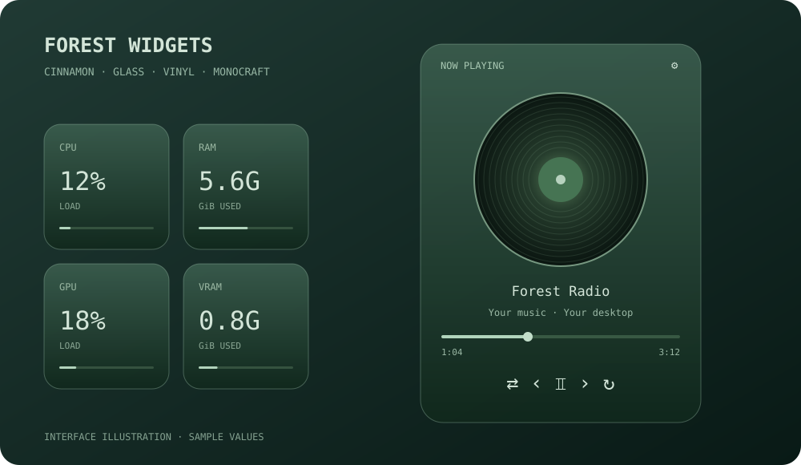

# Forest Widgets

Два независимых виджета для рабочего стола Cinnamon: стеклянные плитки ресурсов и музыкальный плеер с вращающейся пластинкой.

*Glass-style Cinnamon desklets with resource monitoring, a vinyl MPRIS player and crisp native resizing.*



> На иллюстрации показан пример интерфейса. Названия треков и показатели условные.

## Возможности

### Ресурсы

Четыре отдельных квадратика без общей фоновой подложки:

| Плитка | Показатель | Обновление |
| --- | --- | --- |
| CPU | Загрузка процессора | 3 секунды |
| RAM | Занятая оперативная память, GiB | 3 секунды |
| GPU | Загрузка NVIDIA GPU | 15 секунд |
| VRAM | Занятая видеопамять NVIDIA, GiB | 15 секунд |

Квадратики перемещаются вместе как одна группа. NVIDIA опрашивается только при активном состоянии карты; без поддерживаемого датчика GPU и VRAM показывают прочерк. Используются данные первой карты из ответа `nvidia-smi`.

### Виниловый плеер

- Обложка альбома в виде полупрозрачной вращающейся пластинки.
- Название трека, исполнитель и альбом.
- Предыдущий трек, пауза/продолжение, следующий трек.
- Случайный порядок и повтор: выключен → плейлист → один трек.
- Полоса прогресса с перемоткой и показом времени.
- Открытие окна приложения нажатием на имя источника сверху.
- Выбор источника, если запущено несколько MPRIS-плееров.
- Компактный режим без пластинки; настройка скорости и отключение вращения.

Плеер управляет уже запущенным приложением через **MPRIS**. Отдельная авторизация Spotify не требуется. Реальная работа проверена со Spotify; поддержка отдельных кнопок зависит от приложения. Громкость меняется в самом приложении или системной панели — в виджете её регулятора нет.

### Оформление и размер

У каждого виджета собственные настройки:

- Размер **75–160%**, шаг 5%.
- Непрозрачность **40–100%**.
- Выбор шрифта, включая **Monocraft**, вдохновлённый Minecraft.
- Независимое положение плеера и группы ресурсов.

Размер меняет геометрию, шрифты и разрешение рисунка пластинки. Готовая текстура виджета не растягивается, поэтому текст отрисовывается заново в конечном размере.

Стеклянный вид создаётся прозрачностью, градиентом, тонкой обводкой и тенью. Постоянного размытия окон за виджетами нет.

## Совместимость

Проверено на **Cinnamon 6.6.9, X11**. Другие версии Cinnamon и Wayland пока не проверены. GNOME, KDE Plasma, Xfce и Windows не поддерживаются.

Зависимости:

- Cinnamon и его JavaScript API.
- Python 3 с PyGObject — только для установщика.
- GTK/GDK 3, GdkPixbuf и Soup 3 с GI bindings.
- `fontconfig` для установки шрифта.
- `nvidia-smi` — необязательно, только для NVIDIA GPU/VRAM.

На Linux Mint / Ubuntu при отсутствии библиотек:

```bash
sudo apt install python3-gi gir1.2-gtk-3.0 gir1.2-gdkpixbuf-2.0 gir1.2-soup-3.0 fontconfig
```

Не устанавливайте другой драйвер NVIDIA только ради виджета: без датчика остальные функции продолжают работать.

## Установка

Выполняйте команды в обычном терминале своего графического сеанса Cinnamon, **без `sudo`**:

```bash
git clone https://github.com/tetriagen/forest-widgets.git
cd forest-widgets
python3 install.py --check
python3 install.py
```

Установщик копирует виджеты в `~/.local/share/cinnamon/desklets/`, устанавливает Monocraft в пользовательскую папку шрифтов и включает оба виджета. Если они уже включены, их сохранённые положения и пользовательские параметры сохраняются.

Панель задач, системная тема и глобальный шрифт приложений не изменяются. Внешние приложения и проигрыватели не устанавливаются.

Чтобы пропустить установку шрифта:

```bash
python3 install.py --no-font
```

При отсутствии выбранного шрифта система использует запасной. Если Monocraft не появился сразу после первой установки, выйдите из сеанса и войдите снова для обновления кэша рабочего стола.

## Настройка

1. Перетащите каждый виджет в нужное место на рабочем столе.
2. Нажмите **ПКМ → Настроить**. В плеере также доступна шестерёнка **⚙**.
3. Измените размер, непрозрачность и шрифт.
4. В плеере настройте вращение, компактный режим и показ альбома.

Изначально ресурсы имеют размер 110%, плеер — 100%. После изменения размера виджет при необходимости сдвигается внутрь экрана. Положение после перетаскивания сохраняет Cinnamon.

Чтобы выбрать музыкальное приложение: **ПКМ по плееру → Выбрать плеер**. При автоматическом выборе приоритет у воспроизводящего музыку приложения.

## Нагрузка

Виджеты работают внутри Cinnamon. Постоянного отдельного процесса Python нет.

- Музыкальные события передаются через D-Bus.
- Позиция трека уточняется раз в 10 секунд при воспроизведении и видимом плеере; между запросами прогресс считается локально раз в секунду.
- Обложка скачивается при изменении её адреса и не сохраняется на диск.
- Вращение выполняет Clutter; оно приостанавливается на паузе, при скрытом виджете и при обнаружении развёрнутого или полноэкранного окна на текущем рабочем пространстве.
- Полное перекрытие несколькими частично развёрнутыми окнами не определяется.

Точная дополнительная нагрузка CPU/GPU не измерена. Если важна максимальная экономия, отключите вращение или включите компактный режим.

## Отключение и откат

Отключить оба виджета:

```bash
python3 install.py --disable
```

Файлы, настройки и шрифт останутся на диске; виджеты также можно отключить через системное окно Cinnamon «Десклеты».

Перед обновлением существующих файлов установщик сохраняет резервную копию и печатает её путь. Восстановление:

```bash
python3 install.py --restore /путь/к/напечатанной/резервной/копии
```

Откат возвращает сохранённые файлы и положения этих двух виджетов, сохраняя посторонние десклеты. Пользовательские настройки шрифта/размера отдельно не откатываются. Если до установки виджетов не было, восстановление отключит их; установленные файлы и шрифт останутся.

## Если что-то не работает

**Появился прямоугольный фон за карточками.** Проверьте настройки сторонних расширений размытия, например Blur Cinnamon. Отключите его эффекты для этих виджетов или для десклетов. Собственные контейнеры Forest Widgets прозрачные.

**Текст выглядит непривычно.** Monocraft намеренно пиксельный. Выберите системный шрифт или JetBrains Mono, если он установлен. Размер меняйте через настройки виджета, а не стороннее увеличение его текстуры.

**Нет обложки.** Приложение должно передавать `mpris:artUrl`; поддерживаются локальные `file://` и HTTPS-адреса. Без доступной обложки отображается рисунок пластинки.

**Не работает отдельная кнопка или перемотка.** Приложение должно поддерживать соответствующий метод MPRIS. При перемотке отбрасываются устаревшие ответы о позиции; для Spotify есть проверка результата `SetPosition` и однократный запасной вызов `Seek`.

**Нет GPU/VRAM.** Поддержан датчик NVIDIA через `nvidia-smi` и `/sys/class/drm`. Спящая карта, неизвестное состояние питания, AMD и Intel дают прочерк для этих двух плиток.

## Структура проекта

```text
forest-widgets/
├── README.md
├── install.py
├── assets/preview.svg
├── fonts/
│   ├── Monocraft.ttf
│   ├── OFL.txt
│   └── README.md
└── desklets/
    ├── forest-resources@local/
    └── forest-player@local/
```

В каждой папке виджета:

- `desklet.js` — поведение и интерфейс;
- `stylesheet.css` — оформление и размеры;
- `settings-schema.json` — пользовательские настройки;
- `metadata.json` — метаданные Cinnamon.

При изменении базовых размеров в CSS следует обновить и варианты `.forest-size-*`, чтобы сохранить чёткое масштабирование.

## Проверки

- Проверен синтаксис Python и обоих JavaScript-файлов.
- Оба виджета загружались в реальном Cinnamon 6.6.9.
- На 120% и 150% проверены реальные размеры шрифтов и отсутствие растягивания акторов: `scale_x = scale_y = 1`.
- Проверены центрирование диска, прозрачность контейнеров, очистка таймеров и защита перемотки от запоздавших ответов.
- Перемотка проверена на Spotify с последующим возвратом позиции воспроизведения.

## Шрифт и сторонние проекты

[Monocraft](https://github.com/IdreesInc/Monocraft) распространяется под SIL Open Font License 1.1; лицензия включена в `fonts/OFL.txt`. Это не официальный шрифт Mojang.

[Cinnamon](https://github.com/linuxmint/cinnamon) и [MPRIS](https://specifications.freedesktop.org/mpris/latest/) предоставляют API рабочего стола и управления музыкой. Forest Widgets не является официальным проектом Linux Mint или Spotify.

### Свободное место на диске

Под CPU/RAM/GPU/VRAM отображается плоская панель DISK на ширину двух колонок.
FREE — доступное место, TOTAL — полный объём раздела в GiB/TiB; полоска показывает заполнение.
Обновляется каждые 30 секунд без запуска внешних команд. В настройках ресурсов можно
указать путь к папке или точке монтирования (по умолчанию `/`). При недоступном пути
панель показывает `DISK UNAVAILABLE`. Размер, прозрачность и шрифт общие с остальными плитками.
